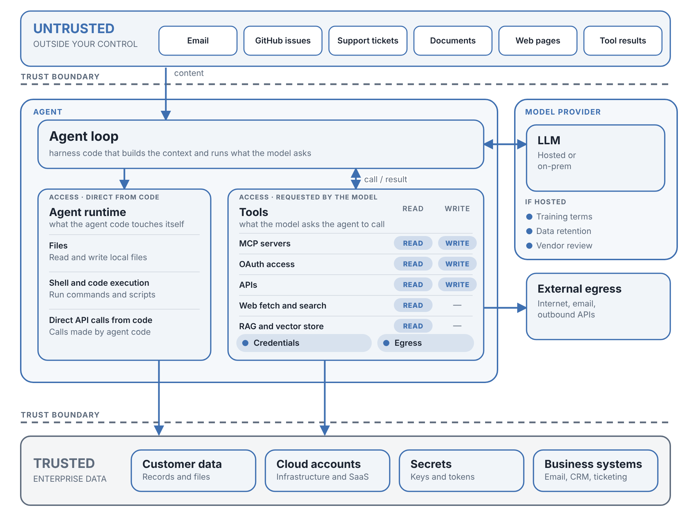

# Interactive AI Agent Threat Model (Beta)

An interactive threat model for AI agents. Set up your agent in six steps and the diagram shows what a compromised or prompt-injected agent could reach, which controls close or limit each path, and what is left.

**Try it:** https://j2abro.github.io/agent-threat-model/

**Background:** [AI Agent Threat Modeling and NVIDIA OpenShell](https://medium.com/@j2abro/ai-agent-threat-modeling-and-nvidia-openshell-4129e187d326)

## What it does

- **Presets:** start from a common setup (YOLO, coding agent on a laptop, autonomous ops agent, OpenShell with full controls, locked down) or answer the questions yourself.
- **Six setup areas:** containment and runtime, model and inference, data access, tools and external systems, approvals and controls, and untrusted inputs.
- **Diagram:** untrusted input, the agent loop, the agent runtime (direct access from code), tools (requested by the model), the model provider, egress and trusted enterprise data. Colors show how exposed each part is.
- **Attack paths:** step through what a compromised agent could do with your current setup, or run the simulation.
- **Findings:** issues for your setup, each with a suggested fix and an OWASP Top 10 for LLM Applications (2026) reference.
- **OpenShell mode:** label the diagram with NVIDIA OpenShell terms, or turn on OpenShell controls to see which paths close and what OpenShell does not cover.
- **Export:** save the diagram as SVG or PNG, or copy a link that keeps your answers.

Everything runs in your browser. It is a single HTML file with no backend and no tracking.

## Run it locally

Download `index.html` and open it in a browser.

## Notes

- This is an early version and is still being tested. Findings and levels come from simple rules. Use it for training and discussion; do your own analysis.
- The OpenShell mapping is my reading of NVIDIA's public documentation. It is not an OpenShell deployment and is not affiliated with or endorsed by NVIDIA.
- Corrections and suggestions are welcome. Please open an issue.

## References

- [NVIDIA OpenShell](https://github.com/NVIDIA/OpenShell) and its [documentation](https://docs.nvidia.com/openshell/)
- [OWASP Top 10 for LLM Applications](https://genai.owasp.org/)
- [OWASP Top 10 for Agentic Applications](https://genai.owasp.org/)

## License

MIT. See [LICENSE](LICENSE).
